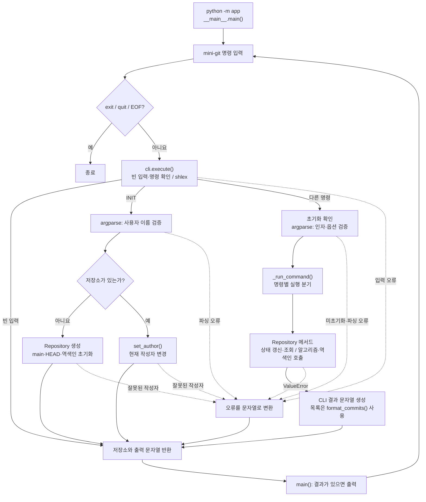

<div align="center">


# Mini Git

커밋 그래프, 브랜치, 역색인을 직접 구현한 메모리 기반 CLI 프로그램<br>
파일 내용 대신 커밋 메타데이터를 관리한다

</div>

## 실행

Python 3.10 이상에서 외부 패키지 없이 실행한다. 저장소 루트에서:

```bash
python -m app
```

## 명령어

| 명령어 | 동작 |
| --- | --- |
| `INIT <user_name>` | 최초 저장소 생성, 초기화 후에는 현재 작성자 변경 |
| `BRANCH <name>` | 현재 커밋을 가리키는 브랜치 생성 |
| `SWITCH <name>` | HEAD를 해당 브랜치로 이동 |
| `COMMIT <message>` | 현재 커밋을 부모로 새 커밋 생성 |
| `LOG` | 부모가 자식보다 먼저 오도록 출력 |
| `LOG --sort-by=date` | 시각 오름차순 출력 |
| `LOG --sort-by=author` | 작성자 오름차순 출력 |
| `PATH <c1> <c2>` | 무방향 최단 경로 출력, 없으면 `No path` |
| `ANCESTORS <hash>` | 자기 자신을 제외한 모든 조상 출력 |
| `SEARCH <keyword>` | 키워드 역색인 검색 |
| `SEARCH --author=<name>` | 작성자 역색인 검색 |
| `exit` / `quit` | 종료. Ctrl+D로도 종료 가능 |

명령어는 대소문자를 구분하지 않는다. 공백을 포함하는 인자는 따옴표로 감싼다.

`INIT Alice`로 시작한 뒤 `INIT Bob`을 입력하면 이후 커밋의 작성자가 Bob으로 바뀐다.
기존 커밋·브랜치·현재 위치는 유지된다.

저장소는 메모리에만 유지되며 프로그램을 종료하면 초기화된다.
해시는 내부에 SHA-256 64자리로 저장하고, 화면에는 앞 8자리만 표시한다.
`PATH`·`ANCESTORS`에는 전체 해시나 유일하게 일치하는 축약 해시를 사용할 수 있다.
`LOG`는 모든 브랜치의 커밋을 출력하며, `[main]` 같은 라벨은 커밋 생성 당시 브랜치다.

## 파일 구조

```text
mini-git/
├── app/
│   ├── __init__.py     # 패키지
│   ├── __main__.py     # REPL 실행
│   ├── cli.py          # 명령 해석·출력
│   ├── models.py       # 커밋 모델
│   ├── repository.py   # 저장소 관리
│   ├── algorithms.py   # 정렬·그래프 탐색
│   └── indexing.py     # 역색인 검색
├── .gitignore          # 추적 제외
├── pyproject.toml      # Ruff 설정
└── README.md           # 사용 설명
```

## 앱 실행 흐름



`execute()`는 저장소 객체와 출력 문자열을 반환한다. REPL이 그 저장소를 재사용하므로
반복 `INIT`으로 작성자를 바꿔도 커밋·브랜치 상태는 유지된다. `ValueError`도 문자열로 반환해
다음 명령을 계속 받을 수 있다.

## 시간 복잡도

`N`은 각 작업에서 처리하는 데이터 크기이며, 구체적인 기준은 설명란에 적었다.
딕셔너리·집합 연산과 정렬 키 비교는 평균 O(1)로 가정한다.
현재 커밋은 부모가 최대 하나이므로 부모 연결 수도 전체 커밋 수 이하다.
CLI 입력 파싱과 출력 비용은 제외한다.

| 작업 | 시간 복잡도 | 설명 |
| --- | --- | --- |
| 최초·반복 `INIT` | O(N) | N은 작성자 이름 길이. 공백 여부를 검사하며, 반복 INIT은 기존 저장소에서 작성자만 변경한다. |
| `BRANCH`, `SWITCH` | O(N) | N은 브랜치 이름 길이. 이름의 해시 계산·비교가 필요하고, 브랜치 표 조회·갱신은 평균 O(1)이다. |
| `COMMIT` | O(N) | N은 메시지·작성자 등 직렬화할 문자열의 전체 길이. JSON 변환, SHA-256 계산, 단어 분리와 역색인 추가를 수행한다. |
| 기본 `LOG` | O(N) | N은 전체 커밋 수. Kahn 알고리즘으로 각 커밋과 부모 연결을 처리한다. 부모 연결 수도 N 이하이므로 선형이다. |
| 정렬 `LOG` | O(N log N) | N은 전체 커밋 수. 목록을 절반씩 나누고 각 단계에서 병합하는 안정 병합 정렬을 사용한다. |
| 전체 해시 해석 | O(1) | 고정된 64자리 해시를 커밋 표에서 직접 조회한다. |
| 축약 해시 해석 | O(N) | N은 전체 커밋 수. 모든 해시의 접두사를 비교하며, 일치하는 커밋이 없거나 여러 개면 오류를 반환한다. |
| `PATH` | O(N) | N은 전체 커밋 수. 해시 해석, 무방향 그래프 생성, BFS와 경로 복원을 수행한다. 현재 부모 연결 수가 N 이하이므로 전체 비용도 선형이다. |
| `ANCESTORS`, 전체 해시 | O(N) | N은 시작점에서 부모 방향으로 도달 가능한 커밋 수. DFS로 조상을 방문하고 시작 커밋은 제외한다. |
| `ANCESTORS`, 축약 해시 | O(N) | N은 전체 커밋 수. 축약 해시 해석을 위해 전체를 순회하고, 그중 도달 가능한 조상을 DFS로 탐색한다. |
| 한 단어 `SEARCH` | O(N) | N은 검색어 길이와 해당 단어의 검색 결과 수를 더한 값. 단어를 해석한 뒤 해당 역색인 목록만 읽는다. |
| 여러 단어 `SEARCH` | 최악 O(N²) | N은 전체 커밋 수와 검색어 길이 중 큰 값. 단어별 색인 목록을 집합으로 만들고 첫 단어의 후보마다 나머지 단어를 검사한다. 커밋 수와 검색 단어 수가 함께 커지는 경우의 상한이다. |
| 작성자 `SEARCH` | O(N) | N은 작성자 이름 길이와 해당 작성자의 커밋 수를 더한 값. 작성자 색인에서 일치하는 커밋만 모은다. |

- 여러 단어 검색은 첫 단어의 목록을 후보로 사용한다. 검색 단어 수가 고정되어 있으면 읽는 색인 목록 크기에 비례한다.
- 작성자 정렬은 이름 비교를 O(1)로 가정한 값이다. 실제 비교에는 이름 길이에 따른 비용이 추가될 수 있다.
- 출력에는 결과 문자열 전체 길이에 비례하는 비용이 별도로 추가된다.

## 코드 검사

```bash
uvx ruff check app
uvx ruff format --check app
```
